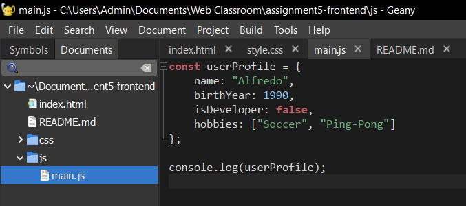
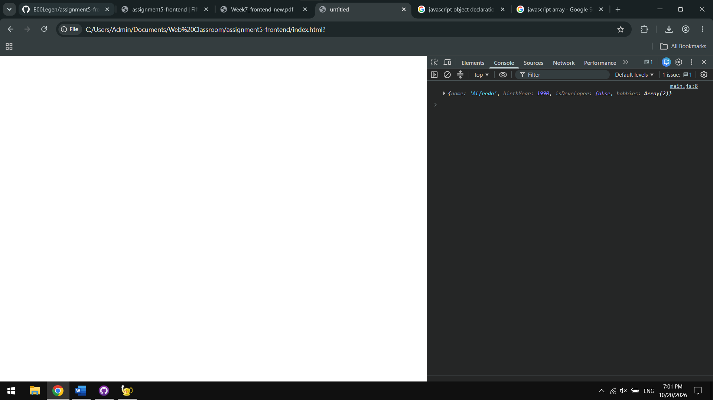
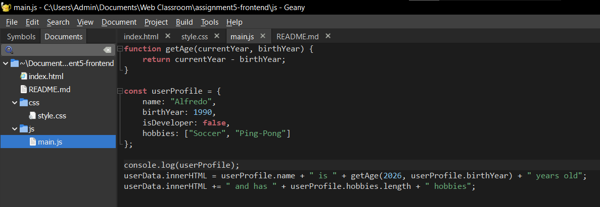
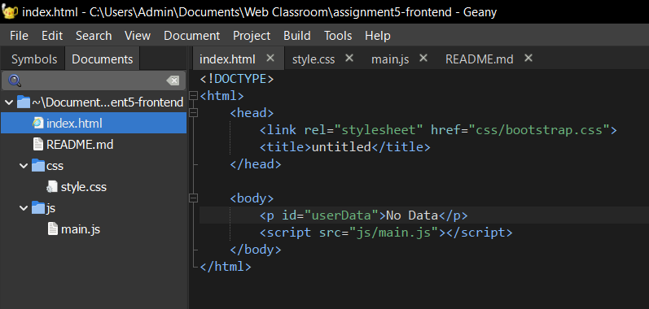
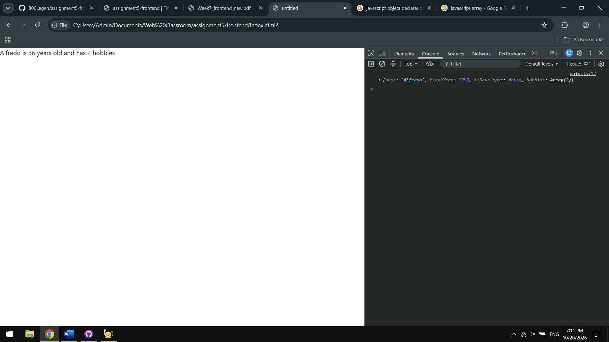
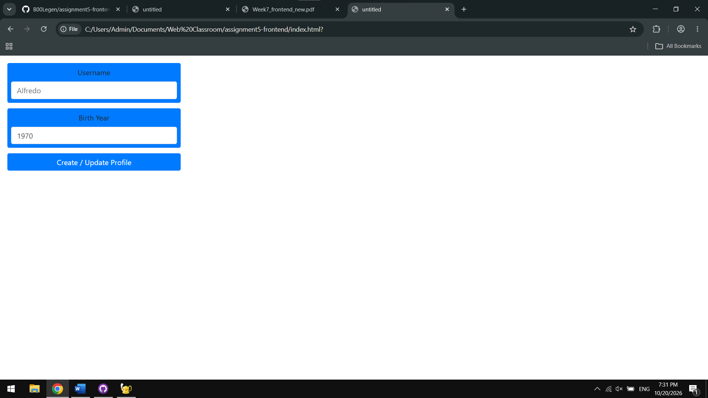
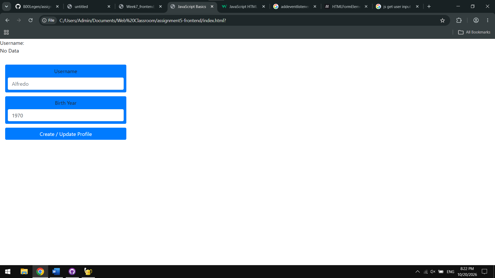

# Assignment 5: JavaScript Basics
Fifth assignment for the `Web Technologies 1` course
### Reporter
`Mukhammedali Bolegen`, `SE-2538`
## Task 1

Basic `JavaScript` class.
## Task 2

Used `innerHTML` and made function `getAge()`.
## Task 3

Made basic `HTML` form.
## Task 4

Added `Event Listener` to the form submission.
## Summary
